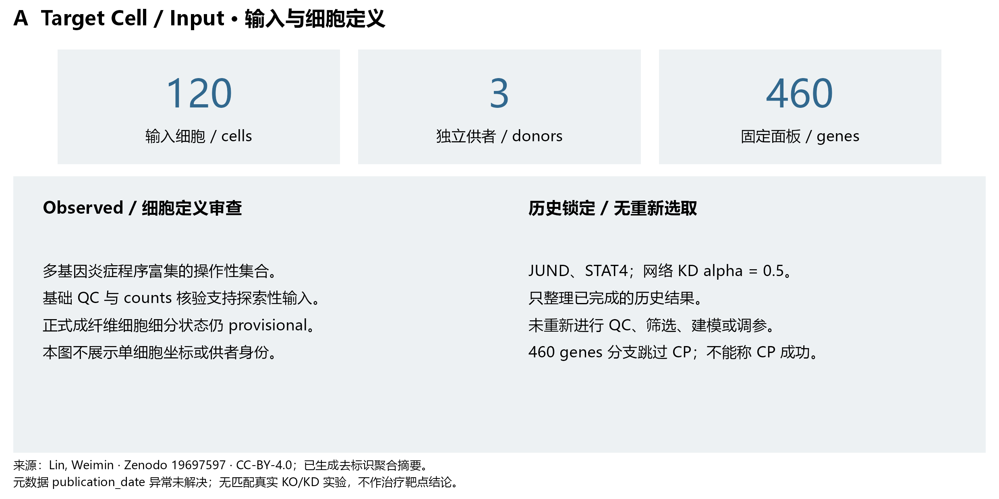
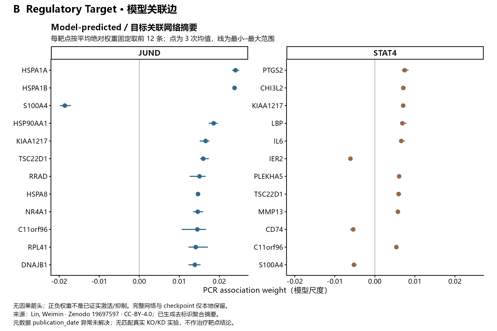
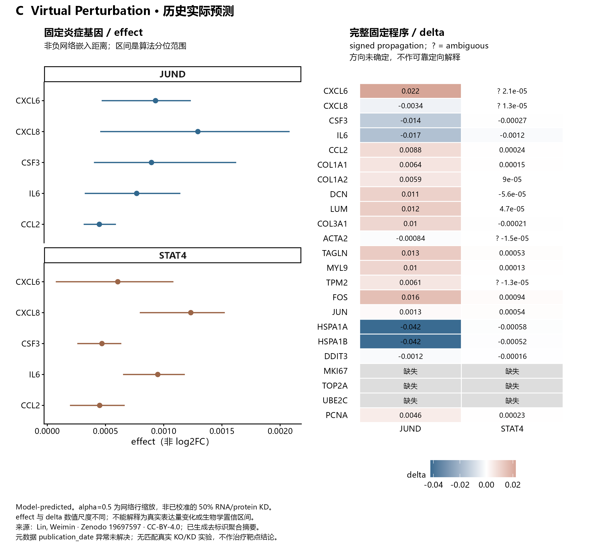
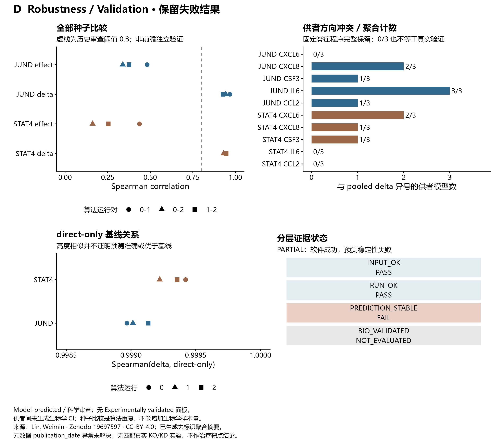

# Figure Gallery / 历史结果图鉴

这四类图来自已完成的 JUND / STAT4 历史数值结果，**没有重新运行数值引擎、筛选细胞或调整参数**。这里只发布去标识的少量 pooled 预测、关联边及聚合稳定性摘要；完整细胞、供者、文库信息、raw counts 和 checkpoint 保留在本地。

English summary: Aggregate figures from a frozen historical replay. Software reproducibility passed; prediction stability failed; no independent biological perturbation validation is available.

| 图件 | 证据层级 | 数据与含义 | 不能得出的结论 |
|---|---|---|---|
| A / Target Cell | Observed，输入审查 | 120 cells、3 independent donors、460 genes；操作性多基因程序富集集合 | 正式炎症性成纤维细胞细分状态或亚群特异性 |
| B / Regulatory Target | Model-predicted | 目标 pooled WT 关联边摘要 | 已证实的因果调控、激活或抑制 |
| C / Virtual Perturbation | Model-predicted | 固定程序的 effect 与 delta | 真实表达 log2FC、分泌量或治疗效果 |
| D / Robustness | Model-predicted、证据审查 | 全部种子比较、供者方向冲突计数及基线关系 | 独立真实 KO/KD 验证或优于简单基线 |

## A · 输入与细胞定义 / Target Cell–Input



**中文图注。** 输入审查覆盖 120 个历史细胞，来源为 3 位独立供者；细胞 ID 与供者 ID 不随图库发布。该集合是多基因炎症程序富集的操作性 subset，正式细分状态仍为 provisional。460 基因面板和 KD alpha=0.5 为旧参数，未重新选择。`Observed` 表示输入与审查事实，不是观察到的真实干扰效应。

## B · 关联网络摘要 / Regulatory Target



**中文图注。** 每靶点按三次算法运行的平均绝对关联权重固定展示前 12 条 pooled WT 边；点为均值，线为最小–最大范围。图件使用同一横轴，不绘制因果箭头。这里的 WT 为官方干扰前关联网络标签，本例并没有实验 WT 与 KO 组。权重是模型关联量，范围是算法重复变异，不是供者置信区间。完整网络仅本地保留。

## C · 实际历史预测 / Virtual Perturbation



**中文图注。** 左侧完整展示固定炎症程序中 5 个基因的非负 `effect` 及官方算法分位范围；右侧展示 5 类既有固定程序的全部基因 `delta`，缺失基因用灰色及“缺失”保留。`effect` 是网络谱/嵌入对齐距离，`delta` 是 signed propagation 分数；数值尺度不同，均不是实测 log2FC。热图标签为两位有效数字，CSV 保留原输出精度。网络 KD alpha=0.5 不代表经实验证实的 50% RNA 或蛋白敲低。未按有利方向筛选或删除基因。

**方向不确定标记。** C 图热图数值前的 `?` 保留官方 `direction=ambiguous`：STAT4 的 CXCL6、CXCL8、ACTA2、TPM2 方向未确定，不能因均值非零就解释为可靠上调或下调。CSV 保留原输出精度、方向及算法符号频率。`ambiguous` 是算法方向判定状态，不是生物学正确概率。

## D · 稳定性、冲突与失败 / Robustness–Validation



**中文图注。** 左上保留每靶点、每种分数的三组全部算法重复配对；点重叠时以源表核查。0.8 虚线来自历史审查形成的锁定报告标准，不是新的前瞻生物学验收。右上保留固定炎症程序中每个靶点×基因与 pooled `delta` 异号的供者模型数，分母为实际参与的供者模型数，未发布逐供者数值或身份。JUND 对 CXCL8 的 pooled/供者冲突为 2/3，对 IL6 为 3/3。左下 `delta` 与 direct-only 的高度相关只说明数值相似，不证明准确性或优于基线。右下保留 `PREDICTION_STABLE=FAIL`、`BIO_VALIDATED=NOT_EVALUATED`。本图没有 `Experimentally validated` 面板。

## 来源、许可与复现 / Provenance and reproduction

数据来源署名：**Lin, Weimin**，[Zenodo 19697597](https://zenodo.org/records/19697597)，记录 API 于 2026-10-10 声明 `license=cc-by-4.0`、`access_right=open`。本图库是重新计算聚合与重新绘制的派生摘要，原数据对象及作者图片不再分发。API 的 `publication_date=2028-04-22` 与核查日期 2026-10-10 冲突，异常尚未解决；不能据此声称记录日期、论文对应关系或全部权利主体已经完整确认。数据署名条件继续适用于派生摘要，不能被仓库自有代码许可证替代。

引擎：[gene-perturb-agent / DoseDirKO](https://github.com/tangaode/gene-perturb-agent)，历史 commit `5254bcfeece32442eee31590fe46bcc4af849181`。图库不包含官方源码、论文图或模型资产；源码再分发许可未确认。有关软件许可见仓库第三方审计说明。

- 参数与状态：[data/historical_summary.json](data/historical_summary.json)。
- 历史源表哈希与发布摘要哈希：[source_manifest.json](source_manifest.json)。源记录只使用相对逻辑标签，不包含私有绝对路径。
- 绘图环境、输入 MD5 与输出索引：[figure_manifest.json](figure_manifest.json)。
- 绘图代码：[plot_gallery.R](plot_gallery.R)，所有图均提供 PNG / PDF / SVG。
- 本地历史到聚合表的转换：[export_history_summary.py](export_history_summary.py)，不调用任何数值引擎。

只重绘发布表即可复现图库，无需下载原矩阵或安装 DoseDirKO：

```powershell
Rscript gallery/plot_gallery.R
# 已有隔离 R 库可作为可选位置参数传入；脚本不会安装依赖。
Rscript gallery/plot_gallery.R <R_library_1> <R_library_2>
```

需要 `ggplot2`、`patchwork`、`ragg`、`svglite`、`jsonlite`；本次验证版本在 manifest 中记录。Windows 默认字体为 Microsoft YaHei；其他系统应选用有中文覆盖的 sans-serif 字体并重新检查字形。图库主要供方法解释与审查，未宣称已符合任何期刊的最终投稿要求。

仅在本地持有经审查历史输出时，才运行以下聚合导出命令；不要把历史原输出加入版本管理：

```powershell
python gallery/export_history_summary.py --historical-output <local_historical_output>
```

科学状态仍为 **PARTIAL**。软件执行成功与历史精确回放，不会自动升级为可靠治疗靶点预测。
